# NetEngine 框架架构设计图

本文从分层、请求流程、数据归属、任务、共享基础设施和部署几个角度说明框架。图中的项目名称对应当前仓库；用户模块、订单模块是多业务场景示例，不代表已经存在第二套业务项目

图使用 Mermaid，可在支持 Mermaid 的 Markdown 预览器中查看。每张图单独标明箭头含义；项目依赖、运行时调用和数据流不能相互替代。完整职责约束见 [架构与项目边界](Architecture.md)

## 1. 整体分层

下图的实线箭头表示主要代码依赖方向，省略 NuGet 包和部分公共依赖。宿主负责把应用服务、数据库及基础设施组装起来

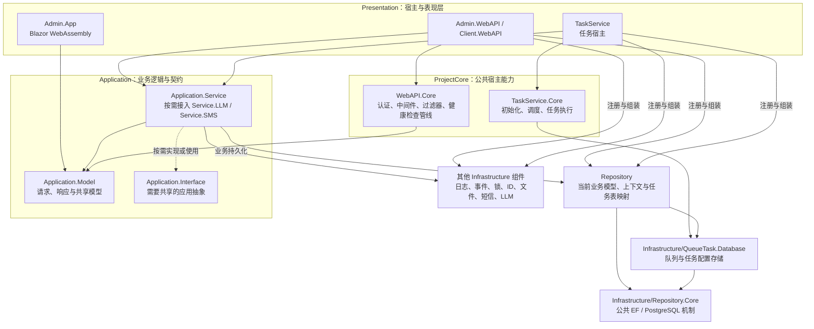

`Application.Service` 和 `Application.Service.LLM` 使用当前业务 Repository；`Application.Service.SMS` 主要依赖短信抽象及应用模型。图中合并显示应用项目，不表示每个项目都依赖所有能力

ProjectCore 不引用具体业务 Repository 或具体 Application.Service。任务执行器调用宿主选定的任务类型，任务方法再调用应用服务。Infrastructure 不反向引用具体业务 Repository 或 ProjectCore

`Admin.App` 还复用 Common 和进程内锁等客户端能力；服务端 Redis 锁不能与浏览器中的进程内锁视为同一种协调范围

## 2. 请求与业务调用

下图表示运行时调用方向。客户端通过 HTTP 调用 API；Controller 负责请求适配和身份传递，应用服务负责业务用例

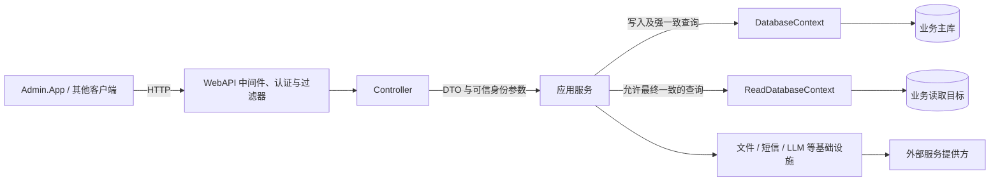

应用服务不从 HTTP 上下文直接读取当前用户；Controller 将 `actorUserId` 等参数明确传入。TaskService 也通过应用服务执行用例，身份来自明确的任务参数或系统调用约定

读上下文复用对应写模型，默认不跟踪实体，读取连接追加默认只读事务配置。未配置独立读连接时可回退主库；配置副本后，保存成功不代表副本已同步。数据库权限仍由数据库账号和目标节点决定

相关用法：[WebAPI](WebAPI.md)、[数据库读写分离](DatabaseReadWriteSeparation.md)、[LLM](LLM.md)

## 3. 数据模型与存储归属

下图表示模型与存储关系，三个数据库节点是逻辑存储目标，可以位于同一个 PostgreSQL 数据库，也可以分别部署

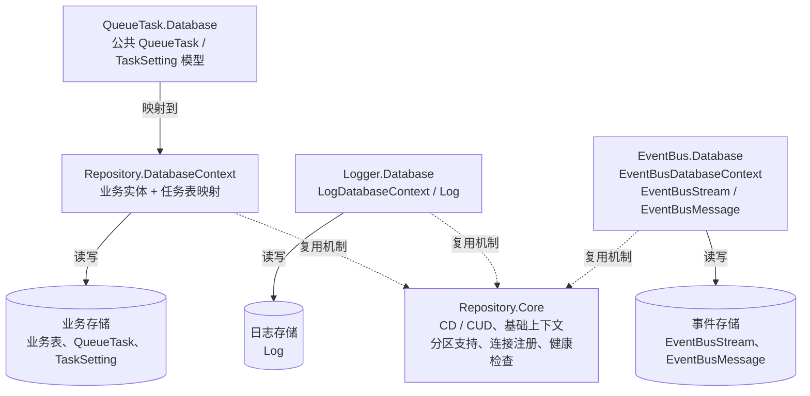

| 能力 | 归属与用途 |
|---|---|
| 业务 Repository | 拥有本模块业务实体和上下文，映射本模块使用的任务表 |
| Repository.Core | 提供公共机制，不拥有具体业务表，也不决定各模块连接哪个数据库 |
| QueueTask.Database | 提供公共任务模型、泛型生产者、存储和管理能力，使用宿主指定的业务上下文 |
| Logger.Database | 拥有 Log 模型、写入与查询上下文，对外提供组件入口 |
| EventBus.Database | 拥有事件模型及上下文；Stream、Message 继承 CD，使用普通表 |

`AddPostgreSqlContext<TContext>` 按具体上下文配置固定连接、迁移历史表和可选分区支持。内部使用 `UseNpgsql(connectionString)`，数据源及连接池交给 Npgsql 提供程序管理，不保证每个上下文类型独占连接池

分区表保存适配和维护由 Repository.Core 提供。各写模型负责自己的分区声明，宿主显式注册对应维护服务；共享物理表的维护者必须使用一致的协调锁目标

相关用法：[业务模块与数据库接入](DatabaseModules.md)、[PostgreSQL 分区表](PostgreSqlPartitionTable.md)

## 4. QueueTask 与 TaskSetting

### 4.1 创建到执行的流程

下图表示运行时的数据流和调用关系。`TContext` 由注册及构造函数注入明确选择，不按任务名称动态选择数据库

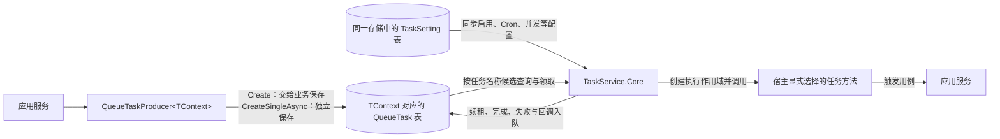

`TaskSetting` 同时服务队列任务及定时任务。定时调度按 Cron 触发选定的任务方法，不要求每次定时触发都先写一条 QueueTask

### 4.2 事务入队

下图表示 `Create` 的调用顺序。业务修改和任务记录使用同一作用域的同一个业务上下文

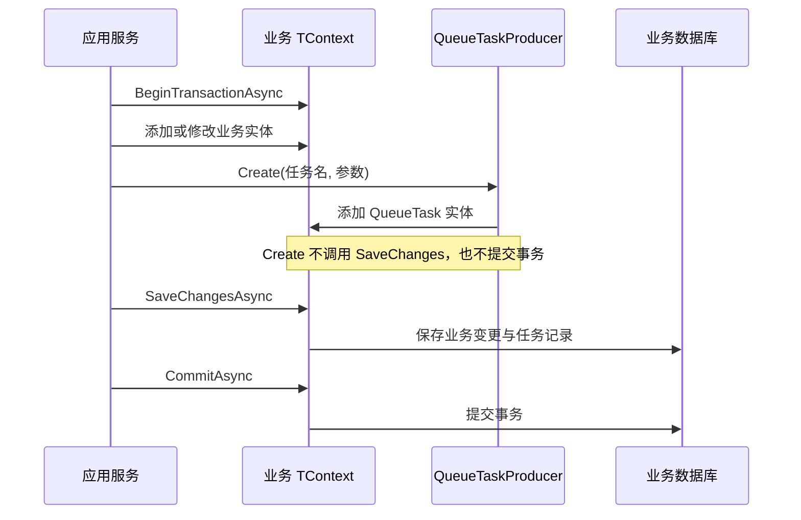

`CreateSingleAsync` 则通过同类型上下文工厂创建新实例，抑制调用方环境事务并独立保存。它写入的仍是该类型配置的目标库，但不会随着调用方业务事务回滚

### 4.3 多个上下文的目标选择

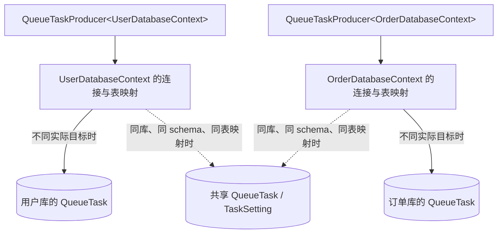

上图实线与虚线表示两种配置选择，不是一次创建同时写入多个目标

同库同表时可以接受共享队列，但应遵守以下约定：

- 独立业务使用不同任务名称，例如 `User.SyncProfile`、`Order.CloseExpired`；Worker 按名称领取任务，TaskSetting 的定义也按类别和名称识别
- 同一物理任务表只由一个明确的迁移入口管理，不能让两套迁移分别创建和修改同一张表
- 管理查询可以看到共享表中的双方任务，任务名称区分不等于访问权限隔离
- 不同上下文实例不会因连接相同而自动共享事务；需要协调同名任务并发的 Worker 副本使用一致的锁配置

一个 API 进程可以注册多个 `QueueTaskProducer<TContext>`。一个 Worker 进程只通过 `AddTaskWorker<TContext>(taskTypes)` 选择一个任务存储及执行类型集合；需要独立消费两个任务库时分别部署 Worker

相关用法：[TaskService](TaskService.md)

## 5. 默认缓存、锁与共享协调

下图表示服务解析及资源连接。Redis 节点按用途区分，不要求它们位于不同服务器

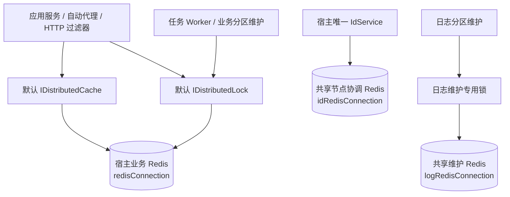

每个宿主集中注册一次默认缓存和锁，业务服务直接注入默认接口。用户、订单等同进程业务通过具体 key 区分，例如 `User:Profile:123`、`Order:Submit:456`。需要协调同一资源的操作使用相同 key，不需要业务模块标识或程序集依赖声明

不同宿主可以通过 Redis 地址、库编号和前缀隔离默认业务资源。ID 及共享日志维护继续显式选择共同协调目标：写入共同唯一性范围的 ID 生成实例共用节点分配范围；维护同一张日志分区表的实例竞争同一把维护锁

ID 节点分配、续期及租约失效检查独立于普通业务缓存。共享 Redis 连接本身不替代节点所有权校验。相关用法：[分布式锁](DistributedLock.md)、[ID 生成器](IdentifierGenerator.md)

## 6. 日志与事件

### 6.1 数据库日志

箭头表示日志写入与查询流程

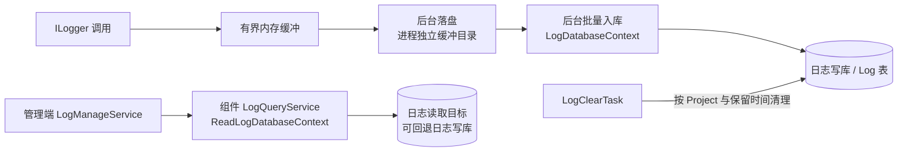

一个宿主只配置一个数据库日志写入目标。多个项目可以共用日志库，以 Project 标记来源，清理仅处理当前 Project。日志查询的 Project 是检索条件，调用方仍负责访问控制

数据库日志采用尽力持久化，不参与业务提交，也不保证绝不丢失；不能代替需要和业务原子提交的审计记录。`Logger.LocalFile` 是另一个可选日志组件，与数据库日志内部的缓冲文件不是同一职责

### 6.2 跨进程广播事件

箭头表示事件保存和各运行实例的消费关系。每个宿主按配置选用一个后端

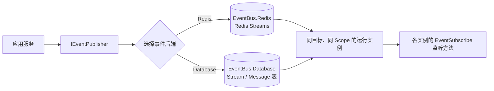

EventBus 用于向所有相应运行实例广播通知；QueueTask 用于竞争领取后执行持久化工作。事件发布成功表示写入后端，不表示监听已经完成，也不与业务事务原子提交

需要业务提交后可靠推进的动作，可以先在业务事务内创建 QueueTask，再由 Worker 调用目标服务或发布事件；接收端仍需幂等处理。相关用法：[数据库日志](DatabaseLogger.md)、[事件广播](EventBus.md)

## 7. 同进程多业务库与拆分部署

下图表示同进程模块通过普通 C# 接口调用的方式。宿主注册契约的本地实现，调用方通过依赖注入获取接口，不需要框架统一包装调用

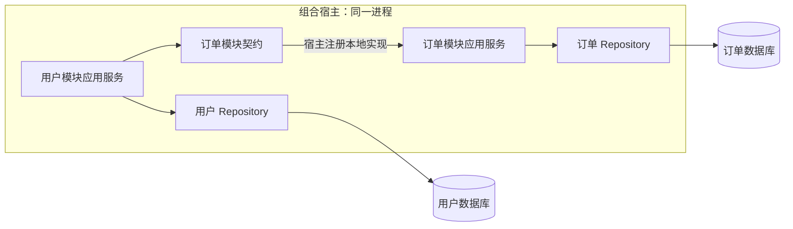

模块间传递请求和结果契约，不传递 EF 实体、IQueryable、数据库连接或事务。是否创建新作用域、开启事务或隔离环境事务，由业务代码明确处理，框架不自动选择。如果 B 已独立提交，A 后续回滚不会撤销 B 的结果；同进程调用不意味着跨库原子事务

拆分为不同进程后，可将本地契约实现替换成 HTTP 或 gRPC 客户端。框架没有提供第二个实际业务模块、通用远程客户端或 `Grpc.Core` 项目，具体通信与失败处理需按业务接入

| 需求 | 当前支持方式 |
|---|---|
| 同进程连接多个业务库 | 每个模块使用独立具体上下文类型和固定连接 |
| 同进程向多个任务库入队 | 注入对应 `QueueTaskProducer<TContext>` |
| 多个上下文共用一套任务表 | 共享存储，任务名称区分业务，单一迁移归属 |
| 各业务独立 Worker | 每个 Worker 选择自己的业务上下文和任务类型 |
| 日志或事件独立部署数据库 | 宿主传入独立连接，分别管理组件迁移 |
| 一个 Worker 消费多个独立任务库 | 当前不支持 |
| 跨模块自动共享事务 | 当前不提供 |

## 8. 编译期生成与运行时注册

下图表示生成过程及生成结果的用途，不表示生成器在每次请求中执行

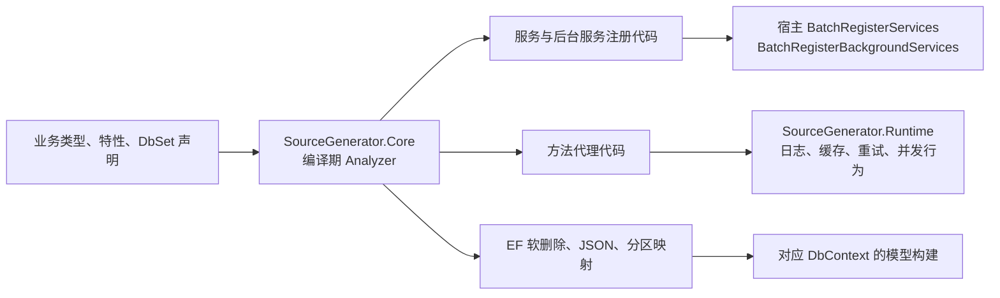

普通业务项目通过 `Directory.Build.props` 隐式接入生成器及运行时。Infrastructure、Deployment 和生成器自身不参与这套默认引用；Logger.Database 和 EventBus.Database 为生成自身 EF 映射显式引用 Analyzer

日志、事件、Worker 及分区维护等组件通过各自扩展入口显式注册。源码生成的后台注册不能代替这些入口，也不应把组件内部服务重复启动。详细规则见 [源码生成器](SourceGenerator.md)

## 9. 数据库工具与部署

下图表示开发及运维操作流程，不是应用正常请求的一部分

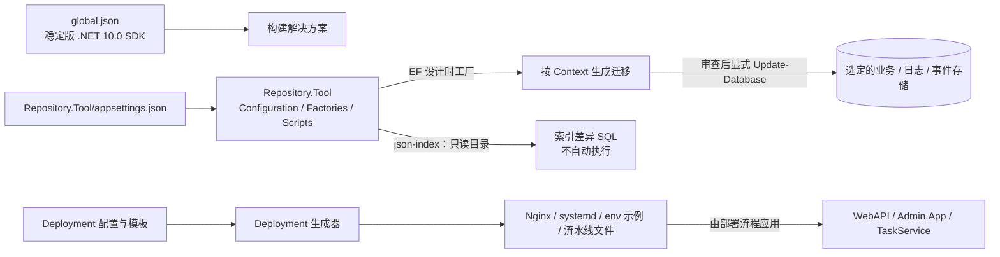

业务、日志和数据库事件分别拥有自己的迁移入口和历史表，读上下文复用对应写模型，不生成独立迁移。工具默认读取自身配置，不依赖启动 WebAPI；框架普通启动不自动执行数据库迁移

日志和事件与业务共用物理数据库时，仍分别管理各自表集合。多个业务上下文共享 QueueTask / TaskSetting 的场景，应单独明确这些共享物理表的唯一迁移归属

Deployment 只生成部署文件，不自动连接服务器或安装服务。健康检查由宿主显式注册，它说明相应连接的可访问性，不代表迁移版本、复制延迟或完整业务用例已经验证

相关用法：[数据库工具](RepositoryTool.md)、[部署配置生成器](Deployment.md)、[快速开始](../README.md#快速开始)

## 10. 关键实现入口

| 关注点 | 代码入口 |
|---|---|
| 宿主组装 | [Admin.WebAPI](../Presentation/Admin.WebAPI/Program.cs)、[Client.WebAPI](../Presentation/Client.WebAPI/Program.cs)、[TaskService](../Presentation/TaskService/Program.cs) |
| 业务模型与上下文 | [DatabaseContext](../Repository/DatabaseContext.cs) |
| 公共数据库注册 | [PostgreSqlServiceCollectionExtensions](../Infrastructure/Repository.Core/Extensions/PostgreSqlServiceCollectionExtensions.cs) |
| 任务表映射及入队 | [QueueTaskModelBuilderExtensions](../Infrastructure/QueueTask.Database/QueueTaskModelBuilderExtensions.cs)、[QueueTaskProducer](../Infrastructure/QueueTask.Database/QueueTaskProducer.cs) |
| Worker 的存储与执行范围 | [TaskWorkerServiceCollectionExtensions](../ProjectCore/TaskService.Core/TaskWorkerServiceCollectionExtensions.cs) |
| 缓存和锁的代理使用 | [CacheableBehavior](../SourceGenerator/SourceGenerator.Runtime/Pipeline/Behaviors/CacheableBehavior.cs)、[ConcurrencyLimitBehavior](../SourceGenerator/SourceGenerator.Runtime/Pipeline/Behaviors/ConcurrencyLimitBehavior.cs) |
| 默认及专用 Redis 锁注册 | [ServiceCollectionExtensions](../Infrastructure/DistributedLock.Redis/IServiceCollectionExtensions.cs) |
| 日志接入 | [ILoggingBuilderExtensions](../Infrastructure/Logger.Database/ILoggingBuilderExtensions.cs) |
| 数据库工具配置 | [ToolDatabaseOptions](../Repository.Tool/Configuration/ToolDatabaseOptions.cs) |
