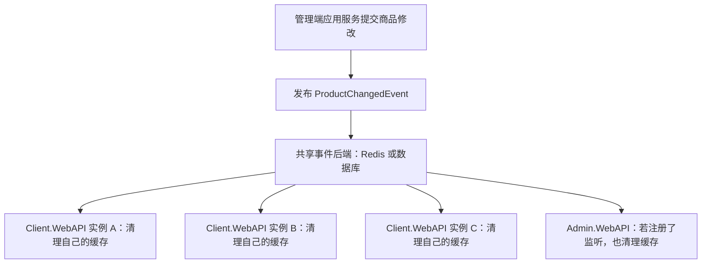

# EventBus：跨进程广播通知

EventBus 用来把一处发生的变化通知给多个正在运行的服务实例，让每个实例更新自己的本地状态。业务代码只需发布一个事件，接收方通过 `[EventSubscribe]` 声明处理方法，无需由发布方逐个调用其他实例

它最适合表达：**“某份数据已经变了，请刷新你自己持有的副本”**。例如商品缓存失效、应用配置重载、内存规则更新。Redis 和数据库是可选的事件存储后端，业务侧的发布与监听写法相同

## 解决什么问题

假设部署了一个 `Admin.WebAPI` 和三个 `Client.WebAPI` 实例，每个客户端 API 实例都缓存了商品信息。管理员修改价格后，数据库已经更新，但其他进程的内存缓存仍可能保留旧价格；只在管理端清理缓存，无法让所有进程都清理自己的内存副本

接入 EventBus 后，处理流程是：



每个注册了对应监听方法的进程都会独立接收，发布进程也不例外。下一次读取商品时，业务再按原有缓存逻辑加载数据。新增实例只需使用相同广播配置并注册监听，发布方不需要知道它的地址或数量

EventBus 还会保留一段时间的事件历史，默认一小时。同一个进程短暂断开后端连接后，可以继续补收这段时间内的通知，减少瞬时连接故障造成的状态遗漏

## 什么时候使用

| 需求 | EventBus 的用法或应选择的能力 |
|---|---|
| 商品、字典、配置修改后，让各实例清理自己的缓存 | 发布变更通知，各实例删除对应缓存键 |
| 运行中的实例需要更新内存规则或配置快照 | 发布变更通知，监听方法重新读取并替换本地状态 |
| 一次变化需要多个模块各自响应 | 为同一事件声明多个监听方法，发布方不依赖这些处理服务 |
| 导出文件、发送短信等工作只需交给一个 Worker 处理 | 使用 [QueueTask](TaskService.md)，由 Worker 竞争领取任务 |
| 当前请求必须拿到处理结果后才能继续 | 直接调用应用服务并等待结果 |
| 扣款、扣库存等业务要求与数据提交原子一致，或进程重启后仍必须补齐所有消息 | 本 EventBus 不提供这类保证，需要另外设计持久化任务或事务消息方案 |

判断依据是：**这件事是否需要每个实例各做一遍，并且可以通过读取当前数据恢复状态？** 如果是，适合广播通知。若只应由一个实例完成业务工作，应选择任务队列

广播异步传播，不能保证保存数据后所有实例立即看到相同状态。进程重启会跳过启动前的事件，因此本地缓存应能重新加载，内存规则应能在启动时从当前数据初始化，不能依赖完整事件历史重建业务状态

## 快速接入：商品修改后清理各实例缓存

以下示例需要自行加入项目，示例事件和监听服务不是模板中已实现的商品功能。代码放置关系如下：

| 内容 | 放置位置 |
|---|---|
| 共享事件 `ProductChangedEvent` | `Application/Application.Model/Events` |
| 缓存监听和业务修改后的发布代码 | `Application/Application.Service` |
| 后端选择、连接与广播范围配置 | 各宿主的 `appsettings.json` / `appsettings.Development.json` |

### 1. 确认参与广播的宿主配置一致

`Admin.WebAPI`、`Client.WebAPI`、`TaskService` 已注册 EventBus，`Application.Service` 已引用公共事件组件。在这些宿主中使用时，无需再添加一遍后端注册，先检查实际运行环境加载的配置：

```json
{
  "EventBus": {
    "Provider": "Redis",
    "Scope": "NetEngine:Production",
    "Retention": "01:00:00"
  }
}
```

需要互通的实例必须使用相同 `Provider`、相同 `Scope` 和相同存储目标。Redis 模式复用 `ConnectionStrings:redisConnection` 对应的连接，还需指向相同 Redis 数据库。开发配置使用 `NetEngine:Development`，会覆盖基础配置；不同环境使用不同 Scope

默认 Redis 后端需要 Redis 6.2 或更高版本。使用数据库后端时，先完成后文的数据库准备，再将 `Provider` 改为 `Database`

### 2. 定义共享事件

在 `Application.Model` 中定义所有参与宿主共同引用的事件类型，只携带定位变化所需的数据：

```csharp
namespace Application.Model.Events;

/// <summary>
/// 商品信息已变更，通知各实例清理对应缓存
/// </summary>
public sealed record ProductChangedEvent(long ProductId);
```

事件表达已经发生的事实。接收方根据 `ProductId` 清理缓存或读取当前状态，不需要发布方传递整份数据库实体

### 3. 在应用服务中声明监听方法

在 `Application.Service` 中添加监听服务：

```csharp
using Application.Model.Events;
using EventBus;
using Microsoft.Extensions.Caching.Hybrid;
using Microsoft.Extensions.DependencyInjection;
using SourceGenerator.Runtime.Attributes;

namespace Application.Service;

/// <summary>
/// 接收商品变化通知并清理当前实例的缓存
/// </summary>
[RegisterService(Lifetime = ServiceLifetime.Scoped)]
public class ProductCacheEventService(HybridCache cache)
{

    /// <summary>
    /// 清理商品缓存，让后续查询重新加载数据
    /// </summary>
    [EventSubscribe]
    public async Task OnProductChangedAsync(ProductChangedEvent message, CancellationToken cancellationToken)
    {

        await cache.RemoveAsync($"product:{message.ProductId}", cancellationToken);

    }

}
```

缓存读取端必须使用相同的 `product:{id}` 键。这个键只是示例；已有业务若使用表达式缓存键扩展，应沿用读取端的键生成方式。`HybridCache.RemoveAsync` 会清理当前实例的一级缓存和共享二级缓存，各实例都执行监听才能清理各自的内存副本

内置宿主已调用 `BatchRegisterServices()`，会注册所引用应用类库中的上述服务；它们也已注册 `HybridCache`。不需要额外实现事件处理接口或手动启动监听循环。一个服务可以声明多个监听方法，同一事件也可以由多个服务分别处理

### 4. 业务提交成功后发布事件

在现有商品应用服务的构造函数中注入 `IEventPublisher eventPublisher`，在保存修改后追加发布调用。以下是现有业务方法中的接入片段，`db` 为该方法使用的写入上下文，`productId` 为已修改商品的 ID：

```csharp
using Application.Model.Events;
using EventBus;

// 在这里完成原有业务校验和商品实体修改
await db.SaveChangesAsync(cancellationToken);

// 业务数据提交成功后，再通知各实例清理缓存
await eventPublisher.PublishAsync(new ProductChangedEvent(productId), cancellationToken);
```

如果存在外层显式事务，应把发布放在 `CommitAsync` 成功之后，而不是仅在 `SaveChangesAsync` 之后

`PublishAsync` 成功表示事件已经保存到后端，不表示监听方法已经执行完成。发布与业务保存是两个独立操作，即使用数据库后端，也不会自动加入当前业务事务；发布失败会抛出异常，此时业务数据可能已经提交。需要业务和消息原子提交的场景不能仅依赖这段写法

### 5. 确认广播产生了预期效果

接入后可按以下方式检查自己的业务链路：

1. 启动至少两个配置相同且已注册监听的实例，等待它们启动完成
2. 分别访问两个实例，让同一商品进入各自缓存
3. 通过已接入发布代码的业务入口修改商品
4. 确认两个实例都执行了监听方法，再分别读取商品，检查缓存重新加载的结果

检查时应确保请求实际到达不同实例，可通过不同端口直连或在监听方法中记录实例标识。缓存刷新是异步的，应在监听完成后观察结果；若读取端使用有复制延迟的读库，还需遵循 [数据库读写分离](DatabaseReadWriteSeparation.md) 的一致性约定，广播不会消除读库延迟

## 编写事件与监听方法的规则

### 事件契约

- 使用非泛型具体类或 `record class`，以具体类型调用 `PublishAsync`，不能用接口、`object` 或父类类型代替实际事件类型
- 事件通过 JSON 传输，完整类型名（命名空间与类型名，不含程序集版本）用于匹配监听；互通宿主应引用一致的事件契约
- 监听只匹配声明的事件参数类型，不自动接收派生类事件；当前进程没有对应监听的事件会被跳过

### 监听服务

- 方法必须是公开的非泛型实例方法，接收一个事件参数，可选第二个 `CancellationToken` 参数
- 返回 `Task` 或 `ValueTask`，不支持 `void`、`async void`、`Task<T>` 或 `ValueTask<T>`
- 服务必须在调用 `AddRedisEventBus` 或 `AddDatabaseEventBus` **之前**加入 DI，普通业务服务沿用 `[RegisterService]` 与 `BatchRegisterServices()`
- 每次调用使用独立的异步作用域，可以注入 Scoped 依赖；需要修改跨请求的内存状态时，应更新实际承载该状态的共享服务，而不是只修改监听对象自身的字段
- 方法不必为了监听声明 `virtual`；若同时使用 AutoProxy，遵循 [代理规则](SourceGenerator.md#autoproxy-方法代理)

监听应短小且幂等，也就是同一事件执行多次仍能得到正确结果。例如删除同一个缓存键，或用最新配置替换快照。不要无条件再次发布相同事件，以免形成广播循环；长时间操作应传递 `CancellationToken`，不要启动脱离监听生命周期的后台任务

同一服务类型有多个监听实现时，应按各自具体类注册，或使用不同的具体 Key，避免解析到错误实现。例如手动注册时：

```csharp
services.AddKeyedScoped<IChangeListener, FirstChangeListener>("first");
services.AddKeyedScoped<IChangeListener, SecondChangeListener>("second");
services.AddRedisEventBus();
```

上述类型为注册方式示意。使用自动注册时，可显式选择服务类型或配置 `Key`，详见 [服务注册规则](SourceGenerator.md#服务类型选择规则)。不支持 `AnyKey`、开放泛型服务和无法从服务契约识别实现类型的工厂注册监听；通过外部实例注册的服务由调用方负责释放

## 断线、失败和重启时会怎样

| 情况 | 实际行为 | 使用时的含义 |
|---|---|---|
| 新进程启动或原进程重启 | 以启动时后端已提交的位置为起点，跳过此前事件 | 启动时从当前数据初始化本地状态，不靠回放旧广播 |
| 同一存活进程短暂断线 | 保留内存中的读取位置，重连后继续补收 | 补收受历史保留时间限制，默认一小时 |
| 离线或积压超过 `Retention` | 事件可能已清理，过期事件不再继续处理 | 无法保证长时间离线后的完整恢复 |
| 某个监听方法抛出异常 | 先尝试当前事件的其他方法，再按间隔重试失败方法 | 当前事件中已成功的方法不会因其他方法失败而重试 |
| 当前事件仍有失败方法 | 当前实例等待重试，成功或事件到期后才继续后续事件 | 失败和耗时监听会拖慢本实例，不影响其他进程 |
| 发布失败或等待取消 | 异常向调用方传播，但写入可能已经完成 | 不能假定抛异常就一定没保存，重复发布或重试都要求监听幂等 |

同一实例按后端记录顺序处理事件，每条事件的监听方法依次调用；不同进程独立处理，完成时间可能不同。`Retention` 从事件在后端的保存时间计算，不是从监听失败时重新计时

宿主启动时需要连接后端以建立起点，后端不可用时会等待恢复。起点建立后收到的事件，会在所有托管服务的 `StartAsync` 完成后开始处理。因此，监听依赖的本地状态应在 `StartAsync` 中初始化，不要在该阶段等待事件监听完成

宿主关闭或事件到期时会请求取消监听，并等待其退出，无法强制终止不配合取消的代码。读取和历史清理失败会记录日志并重试；广播后台循环意外终止时会记录严重错误并停止宿主

## 后端选择与配置

| 后端 | 适用条件 | 接入准备 |
|---|---|---|
| `Redis`（默认） | 已有 Redis，希望复用它存储短期通知 | Redis 6.2+，宿主已注册 `IConnectionMultiplexer` |
| `Database` | 希望复用已有关系数据库保存通知 | 主库 `IDbContextFactory<TContext>`、事件模型映射和对应表 |

后端只改变事件存储方式，广播、重启起点和监听重试规则保持一致。数据库后端同样不提供重启后的历史回放，也不自动实现业务事务消息

内置三个宿主通过 `EventBus.Provider` 选择后端，修改配置后重启。互通实例需一起使用相同后端和存储目标，不同后端之间不会自动转发事件。选择 Database 也不会取消宿主其他能力对 Redis 的依赖

### 新宿主接入

已有三个宿主无需重复以下注册。新增宿主时，应用服务引用 `Infrastructure/EventBus`；宿主根据后端引用 `Infrastructure/EventBus.Redis` 或 `Infrastructure/EventBus.Database`

先注册业务服务和后端依赖，再选择一个后端：

```csharp
using EventBus.Redis;

builder.Services.BatchRegisterServices();

// 此前应已注册 IConnectionMultiplexer 和监听服务所需的依赖
builder.Services.AddRedisEventBus(options =>
{
    options.Scope = "NetEngine:Production";
    options.Retention = TimeSpan.FromHours(1);
});
```

使用数据库时，用以下注册替换 `AddRedisEventBus`，并提前注册主库上下文工厂：

```csharp
using EventBus.Database;
using Repository;

builder.Services.AddDatabaseEventBus<DatabaseContext>(options =>
{
    options.Scope = "NetEngine:Production";
    options.Retention = TimeSpan.FromHours(1);
});
```

同一宿主只能注册一个后端，扩展方法已包含广播运行服务，无需额外调用 `AddHostedService`。手动接入时由所调用的扩展方法选择后端；`Provider` 是内置宿主读取配置后选择扩展方法的依据

### 数据库后端准备

内置 `DatabaseContext` 已调用 `modelBuilder.ConfigureEventBus()`。启用前，需要通过已有 [Repository.Tool 迁移入口](../README.md#快速开始)准备以下两张表；宿主不会自动建表，缺表时无法完成广播初始化

| 表 | 用途 |
|---|---|
| `EventBusStream` | 保存各 Scope 的已提交位置 |
| `EventBusMessage` | 保存事件内容、位置与发布时间 |

复用其他上下文时，引用 `Infrastructure/EventBus.Database`，并在原有 `OnModelCreating` 中补充映射：

```csharp
using EventBus.Database;
using Microsoft.EntityFrameworkCore;

/// <summary>
/// 配置业务模型和事件存储模型
/// </summary>
protected override void OnModelCreating(ModelBuilder modelBuilder)
{

    modelBuilder.ConfigureEventBus();
    // 保留当前上下文已有的业务映射

}
```

数据库连接、提供程序和拦截器沿用主库上下文工厂。广播需要及时读取已提交事件，应使用 `DatabaseContext` 主库工厂，不能改用允许复制延迟的 `ReadDatabaseContext`

### 配置项

以下默认值来自 `EventBusOptions`，内置宿主会用配置文件覆盖 `Scope` 等选项：

| 选项 | 默认值 | 用途 |
|---|---|---|
| `Provider` | `Redis` | 内置宿主选择 `Redis` 或 `Database` |
| `Scope` | `NetEngine` | 广播范围，使用项目与环境区分，非空且不超过 200 个字符 |
| `Retention` | `01:00:00` | 历史保留时间，也是事件处理和失败重试的时间边界 |
| `PollInterval` | `00:00:01` | 每轮未读满一批或读取失败后的等待时间 |
| `RetryInterval` | `00:00:01` | 当前事件失败方法的重试间隔 |
| `CleanupInterval` | `00:01:00` | 过期事件的物理清理间隔 |
| `BatchSize` | `100` | 每批读取条数，范围为 1 到 1000 |

`Retention` 必须大于零；三个间隔选项有效范围为 1 到 4294967294 毫秒（约 49.7 天），无效配置会导致启动失败。同一广播范围的实例应保持一致的 `Retention`，因为任一实例的清理都会影响共享历史

Redis 使用 `eventbus:<Scope>` 作为事件流键，持久化与容灾由 Redis 部署负责。两种后端都会物理清理过期事件，保留历史的用途是短暂断线补收，不应把它当作业务审计记录

## 扩展其他后端

需要接入其他存储时，实现 [IEventTransport](../Infrastructure/EventBus/IEventTransport.cs)，在业务服务注册完成后调用 `AddEventBus<TTransport>`。后端负责保存事件、建立已提交起点、按可靠位置读取和清理历史，业务侧继续使用 `IEventPublisher` 与 `[EventSubscribe]`

`EventEnvelope` 包含事件标识、类型名称和 JSON 参数，`EventRecord` 补充后端位置与保存时间。位置由后端解释；如果必须跳过无效记录，应先记录告警，再返回保留原 `Position`、`Message` 为 `null` 的记录，让读取位置继续推进
